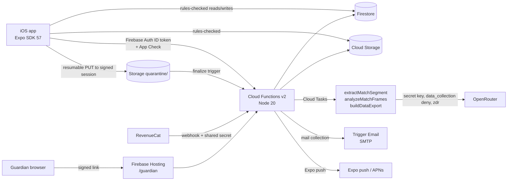

# Security Architecture

## Components

## Trust boundaries and controls

| Boundary | Control | Where |
| --- | --- | --- |
| App → backend | Firebase Auth ID token on every callable; App Check enforced on callables outside the emulator unless `ENFORCE_APP_CHECK=false` | `functions/src/callableOptions.ts` |
| Browser origins | Callables allow only `CALLABLE_ALLOWED_ORIGINS` (exact https origins); none by default. The iOS app sends no Origin header | `resolveCallableCors`, `tests/unit/callableCors.test.ts` |
| Client data access | Firestore and Storage rules: owner-only by default, server-written fields (age band, scopes, entitlements, moderation state) cannot be written by clients | `firestore.rules`, `storage.rules`, rules tests |
| Uploads | Bytes land in `quarantine/{uid}/` (no client read/write via rules). Promotion to `profiles/{uid}/` happens only after server ffprobe validation | `functions/src/uploads/` |
| AI | `OPENROUTER_API_KEY` is a Functions secret. Production builds fail if `EXPO_PUBLIC_OPENROUTER_API_KEY` is set | `app.config.ts`, `functions/src/ai/` |
| Premium | Entitlement written only by the RevenueCat webhook (shared secret) and read by server quota checks. The client value of `isPremium` is never trusted | `functions/src/entitlements/` |
| Guardian | HMAC-signed tokens with expiry (`GUARDIAN_LINK_SECRET`); only the token hash is stored; decision only on the web page | `functions/src/safety/guardianToken.ts`, `youthConsent.ts` |
| Staff | `staffRole` custom claim (`moderator` / `admin`), granted only by accounts in the `ADMIN_USER_IDS` secret; destructive actions need a sign-in within 15 minutes; every action goes to the append-only `adminAuditLog` | `functions/src/moderation/staff.ts` |
| Notifications | Server-composed copy only; clients cannot forge pushes to other users; minors get generic lock-screen text | `pushDelivery.ts`, `notificationPolicy.ts` |
| Deep links | Allow-listed path patterns, validated ids, auth gate before protected screens | `src/navigation/deepLinkResolver.ts` |
| Device storage | Auth tokens in `expo-secure-store`; GPS coordinates never persisted | `docs/SECURE_STORAGE.md`, `gpsTrackingService.ts` |
| Diagnostics | Sentry only in production builds, `sendDefaultPii: false`, request/extra/context data scrubbed | `src/config/sentry.ts` |

## Secrets

Stored with `defineSecret` (Google Secret Manager): `OPENROUTER_API_KEY`, `REVENUECAT_WEBHOOK_SECRET`,
`GUARDIAN_LINK_SECRET`, `ADMIN_USER_IDS`, `APPLE_TEAM_ID`, `APPLE_KEY_ID`, `APPLE_PRIVATE_KEY`.
None are in the repository. `GoogleService-Info.plist` is not committed and is provided to EAS as a
file secret.

## Public client configuration

`EXPO_PUBLIC_*` values are bundled into the app and are not secrets: Firebase web config, Google
client ids, Sentry DSN, RevenueCat public iOS key, App Check site key, app link host.
